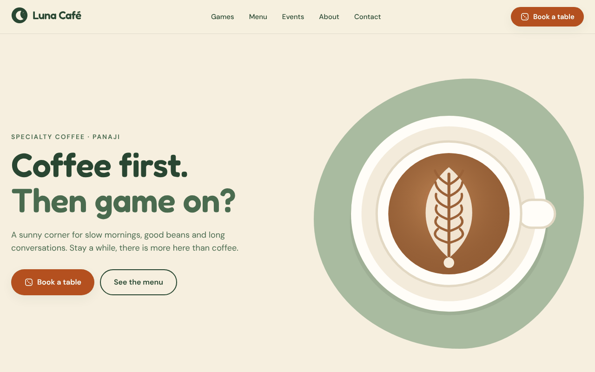
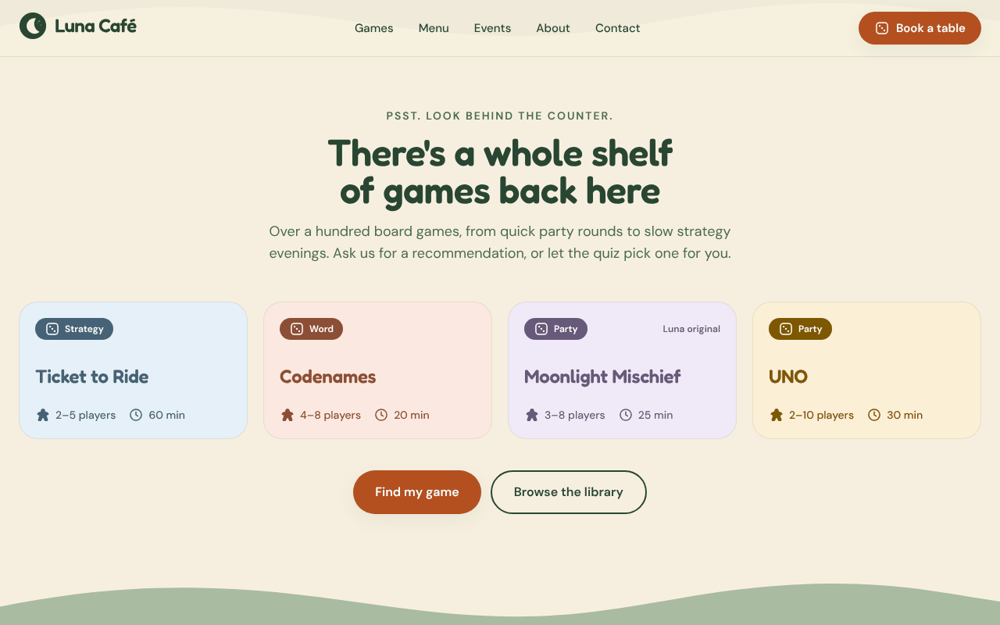
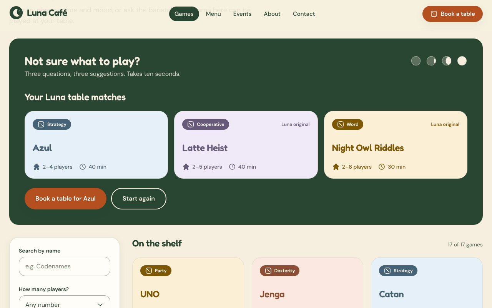
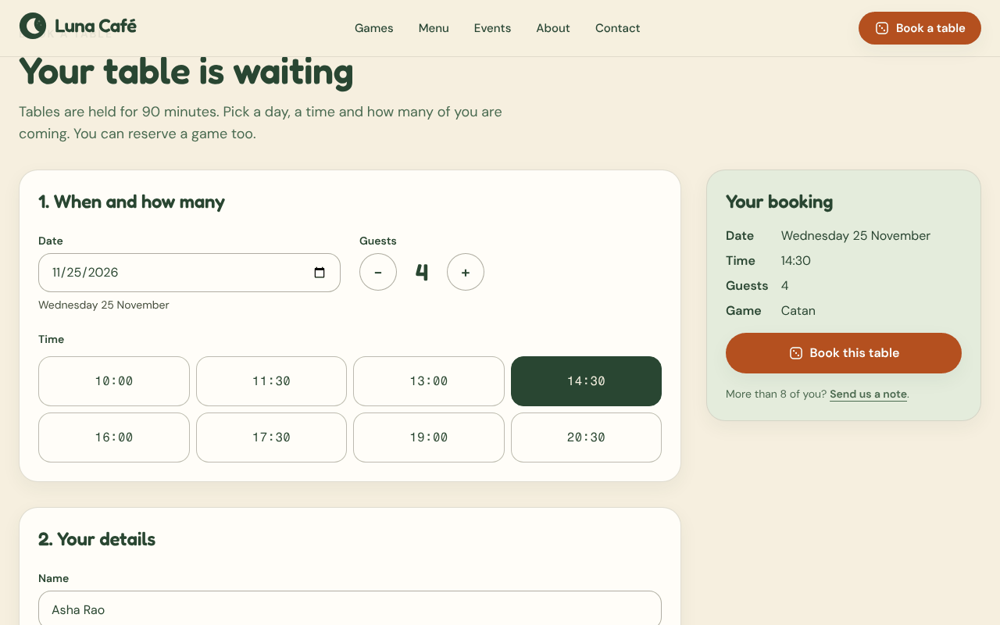
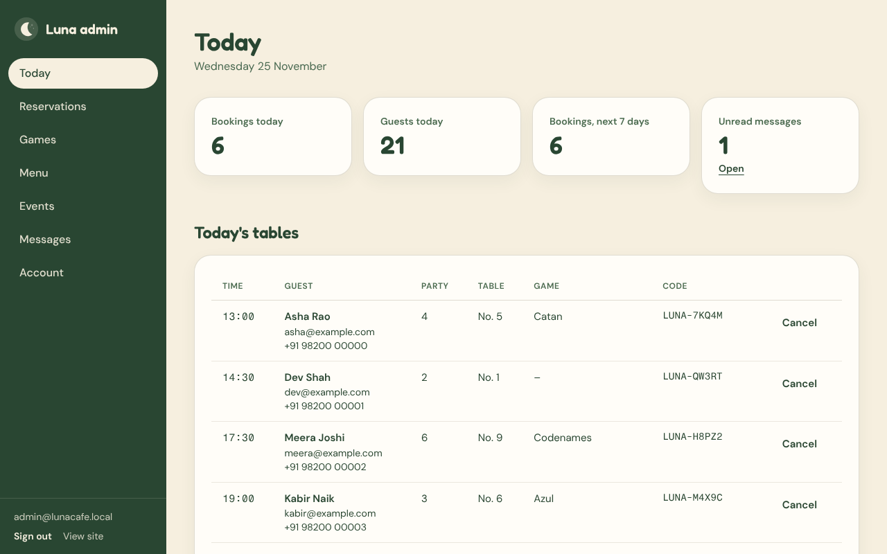
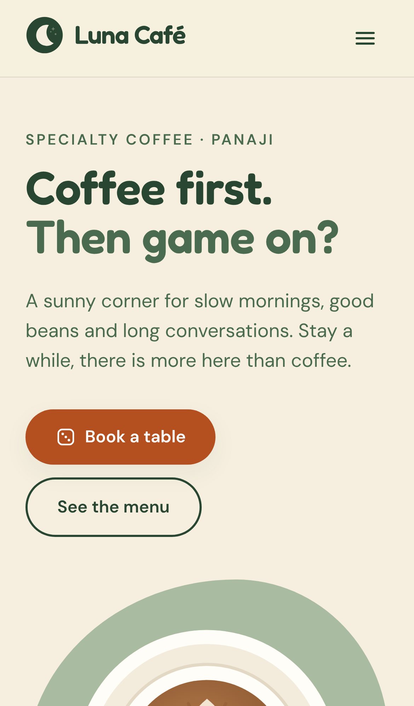
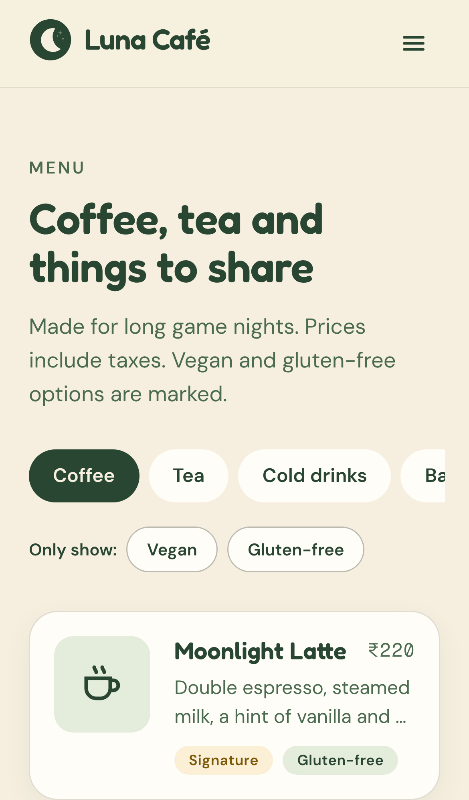
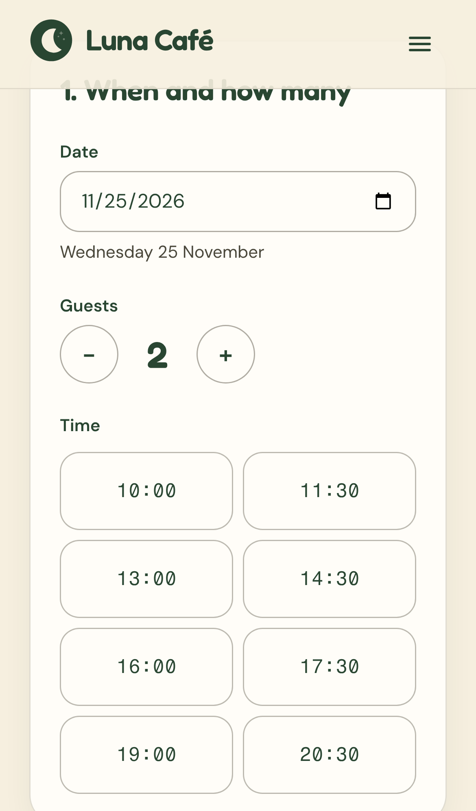

# Luna Café

> Coffee first. Then game on?

A portfolio project: the website of a fictional board game café. It opens as a calm specialty coffee shop, and the board game side is revealed as you scroll.

**Live:** https://lunaacafe.vercel.app · **Status:** all features built and deployed (public pages, booking, game quiz, events, Moon Club card, admin). See [`docs/SPEC.md`](docs/SPEC.md) for the original plan.

<p>
  
  
  
  
  
  
</p>
<p>
  
  
  
</p>

More: [game library](docs/screenshots/games-library.png) · [booking confirmed](docs/screenshots/book-confirmed.png) · [Moon Club card](docs/screenshots/moon-club.png)

## Stack

- **Client:** Vite, React 19, TypeScript, Tailwind CSS v4, Motion, React Router, TanStack Query
- **Server:** Node 22, Express 5, TypeScript, Mongoose (MongoDB Atlas), zod
- **Hosting:** Vercel (client, rewrites `/api` to the server), Render (API), MongoDB Atlas M0

## Project layout

```
client/   React app
server/   Express API
e2e/      Playwright end-to-end tests
docs/     spec
design/   Stitch mockups and the original design-system notes (visual reference only)
```

## Run it locally

1. Install dependencies: `npm run install:all`
2. Create `server/.env` from `server/.env.example` and set `MONGODB_URI` (and the admin values).
3. Seed the database: `npm --prefix server run seed` (tables, games, menu, four upcoming sample events, admin account). Safe to run again: it updates instead of duplicating, and keeps event sign-ups.
4. Start the API: `npm run dev:server` (http://localhost:4000/api/health)
5. Start the site in a second tab: `npm run dev:client` (http://localhost:5173)

## Admin

The staff area lives at `/admin` (not linked from the site, and `robots.txt` asks search engines to skip it). Sign in with `ADMIN_EMAIL` / `ADMIN_PASSWORD` from `server/.env`; the account is created by `npm --prefix server run seed`.

- **Today:** bookings and guests today, bookings this week, unread messages, today's tables
- **Reservations:** filter by date range and status, cancel (frees the table immediately)
- **Games, Menu, Events:** add, edit, hide (untick "Available") or delete
- **Messages:** contact-form messages, mark read/unread, delete
- **Account:** change the admin password (at least 12 characters; signs out every other session)

Security: rate limits key on the visitor's real IP (Express trusts two proxy hops in production: Vercel's rewrite and Render's proxy; override with `TRUST_PROXY_HOPS`), bcrypt-hashed password, 8-hour JWT in an httpOnly, SameSite=Lax cookie (Secure in production), login rate limit, same error for unknown email and wrong password, and admin POSTs must be JSON (blocks cross-site form posts).

## Performance and accessibility

Lighthouse (production build, Vercel headers, Brotli; mobile uses Lighthouse's slow-4G throttling):

| Page | Mobile perf | Desktop perf | Accessibility | Best practices | SEO |
|---|---|---|---|---|---|
| Home | 88–90 | 98 | 100 | 100 | 100 |
| Games | 91 | 97 | 100 | 100 | 100 |
| Menu, Book, Events, About, Contact | 92–95 | — | 100 | 100 | 100 |

What keeps it fast: every page except Home and the animation engine load on demand; the hero headline uses a CSS entrance so it paints without waiting for JavaScript; fonts are self-hosted; built assets are cached for a year. No layout shift (CLS 0).

The free API sleeps when idle. The site waits up to 2.5 minutes for it with a "Waking up the café…" banner, retrying reads, and retrying writes only when the request clearly never reached the server (so nothing is saved twice).

## Hero photo

Until the photo is ready the hero shows a drawn latte. To switch: save the photo as `client/public/images/hero.webp` (about 1600 × 1600, under 200 KB) and fill in `HERO_PHOTO` in `client/src/lib/cafe.ts`.

## Tests

- `npm test`: server tests (Vitest + Supertest against a throwaway in-memory MongoDB; the first run downloads it). They cover café hours and slots in café time (Asia/Kolkata), smallest-table assignment, double booking blocked under simultaneous requests (unique database index), cancellation freeing a slot, nearest free times, event sign-ups that never overfill, admin auth (cookie flags, CSRF guard, password change ending other sessions), the proxy/IP setup behind Vercel and Render, and API validation errors.
- `npm --prefix client test`: client unit tests (quiz scoring, moon phases, cold-start retry rules).
- `npm run e2e`: Playwright end-to-end tests on the built app with a real API and MongoDB, on desktop and a phone-sized screen: book a table with a game and cancel it as staff, a full slot can't be picked, the quiz, filters surviving a reload, a contact message reaching the admin inbox, and admin pages needing a session. Needs `MONGODB_URI` pointing at a throwaway database plus `ADMIN_EMAIL` / `ADMIN_PASSWORD`; it seeds that database first.

CI (GitHub Actions) runs all three on every push and pull request; the end-to-end job uses a MongoDB service container and uploads the Playwright report if anything fails.

## API

| Method | Path | Notes |
|---|---|---|
| GET | `/api/health` | `{ status, db }` |
| GET | `/api/games` | available games |
| GET | `/api/games/:slug` | one game |
| GET | `/api/menu` | available menu items |
| GET | `/api/menu/special` | today's special (falls back to a signature drink) |
| GET | `/api/reservations/slots` | the fixed time slots |
| GET | `/api/reservations/availability?date=YYYY-MM-DD&partySize=4` | free / full / past / closed per slot |
| POST | `/api/reservations` | `{ name, email, phone, date, slotId, partySize, gameId? }` → reference code, or 409 with suggestions |
| POST | `/api/contact` | `{ name, email, message }` |
| GET | `/api/events` | upcoming events with `spotsLeft` (never who signed up) |
| POST | `/api/events/:slug/signup` | `{ name, email }`; 409 when full or already signed up |
| POST | `/api/auth/login` · `/api/auth/logout` | admin session cookie |
| GET | `/api/auth/me` | current admin |
| POST | `/api/auth/password` | `{ currentPassword, newPassword }` (admin) |
| * | `/api/admin/games`, `/menu`, `/events` | list, create, `PATCH /:id`, `DELETE /:id` (admin) |
| GET | `/api/admin/summary`, `/api/admin/reservations?from&to&status`, `/api/admin/messages` | admin |
| PATCH | `/api/admin/reservations/:id/cancel`, `/api/admin/messages/:id` | admin |

## Deploying

The API runs on Render (free), the site on Vercel, the data on MongoDB Atlas. Vercel forwards `/api/*` to Render, so the browser only ever talks to one address (and the admin cookie stays first-party).

**1. MongoDB Atlas**
- Network Access → Add IP address → `0.0.0.0/0` (Render's free plan has no fixed IP). Keep a strong database password.
- Seed once from your machine: `npm --prefix server run seed`.

**2. API on Render**
- Dashboard → New → Blueprint → choose this repo. It reads `render.yaml` (service `luna-cafe`, root `server`, branch `main`).
- Or create a Web Service by hand: root directory `server`, build `npm ci --include=dev && npm run build`, start `npm start`, health check `/api/health`, and add `NODE_ENV=production`, `NODE_VERSION=22`, `MONGODB_URI`, `CLIENT_ORIGIN` and a random `JWT_SECRET`.
- Fill in `MONGODB_URI` (same as `server/.env`) and `CLIENT_ORIGIN` (your Vercel address, e.g. `https://luna-cafe.vercel.app`). `JWT_SECRET` is generated for you.
- When it is live, open `https://luna-cafe.onrender.com/api/health`. It should say `"db":"connected"`.
- The free plan sleeps after 15 minutes without traffic and takes about a minute to wake. The site shows a "Waking up the café…" note meanwhile. No keep-alive ping on purpose: the free hours are shared with other projects in the same Render workspace.

**3. Site on Vercel**
- Vercel → Add New → Project → import `Luna-Cafe`. Set **Root Directory** to `client`. Everything else comes from `client/vercel.json` (Vite, `npm ci`, `npm run build`, output `dist`, Node 22). No environment variables are needed.
- `client/vercel.json` forwards `/api/*` to `https://luna-cafe.onrender.com`. If Render gave your service a different address (it adds a suffix when the name is taken), change that one line and push.
- Deep links (`/games`, `/admin/…`) fall back to the app; `/assets/*` is cached for a year (file names change on every build).
- Security headers: a strict Content-Security-Policy (only this site's own scripts, styles, fonts and API), `nosniff`, `frame-ancestors 'none'`, HSTS, a tight Permissions-Policy, and `noindex` on `/admin`.
- Production branch: `main`. Every pull request also gets its own preview URL.

**4. Check it**

```
npm run smoke -- https://your-site.vercel.app
```

The smoke test loads the site, a deep link and the `/admin` headers, then waits (up to two minutes) for the API to wake and checks health, games, menu, events and that the admin API is locked.

---

Portfolio project, fictional café. Game names belong to their owners.
