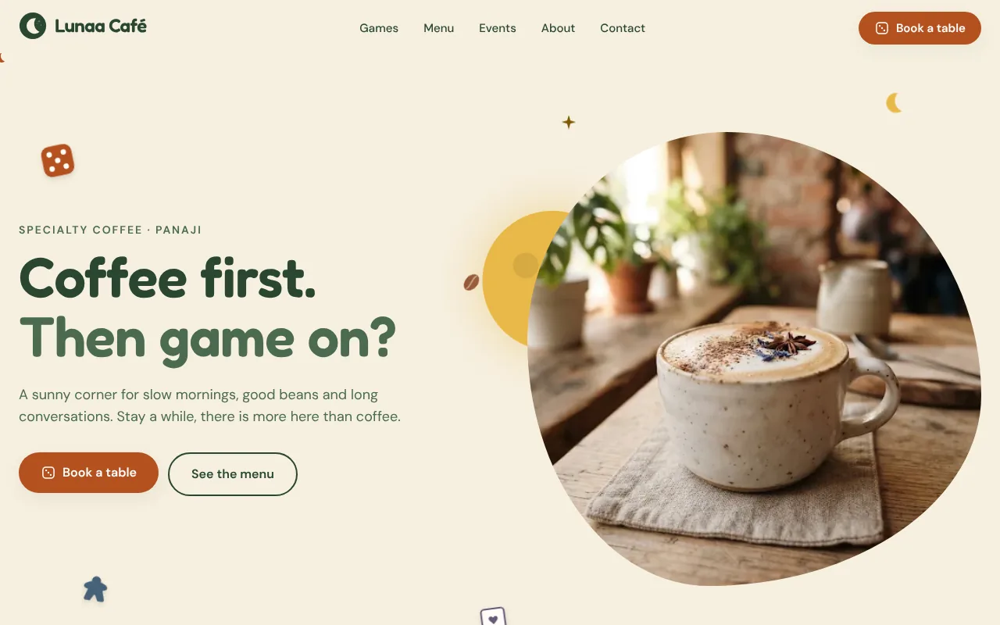
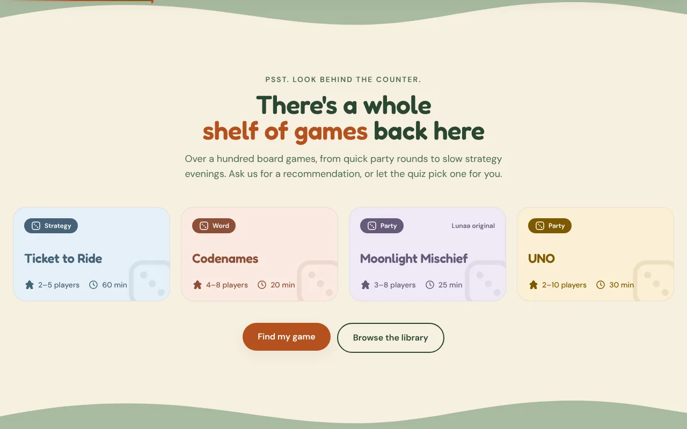
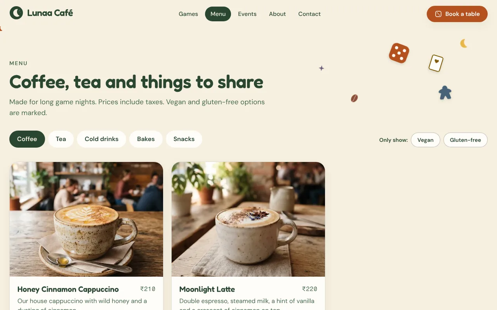
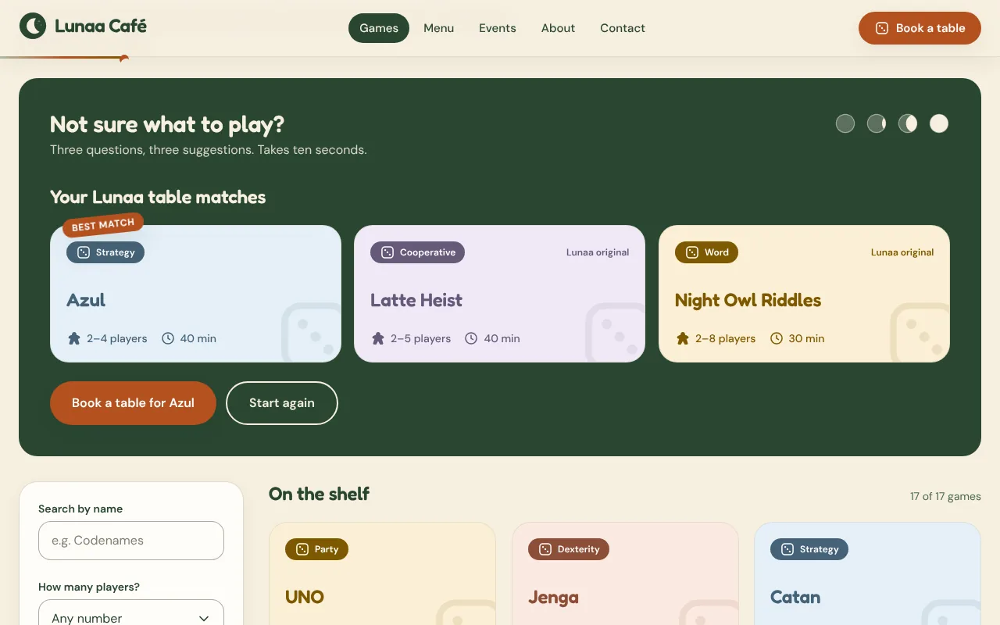
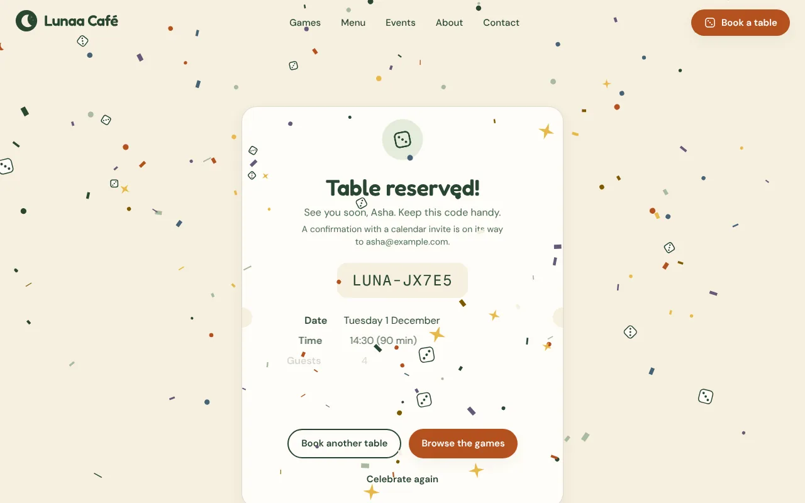
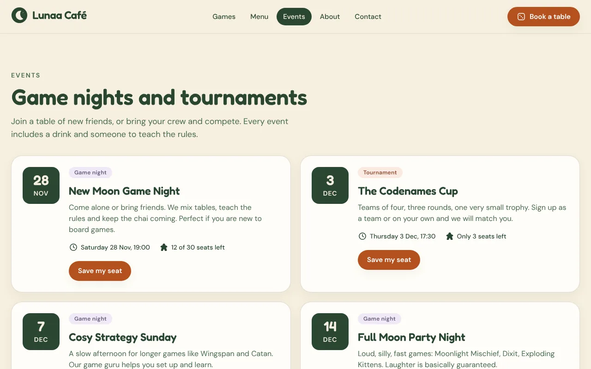
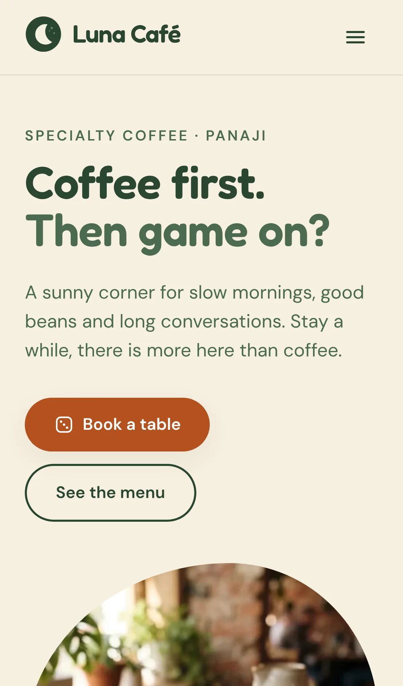
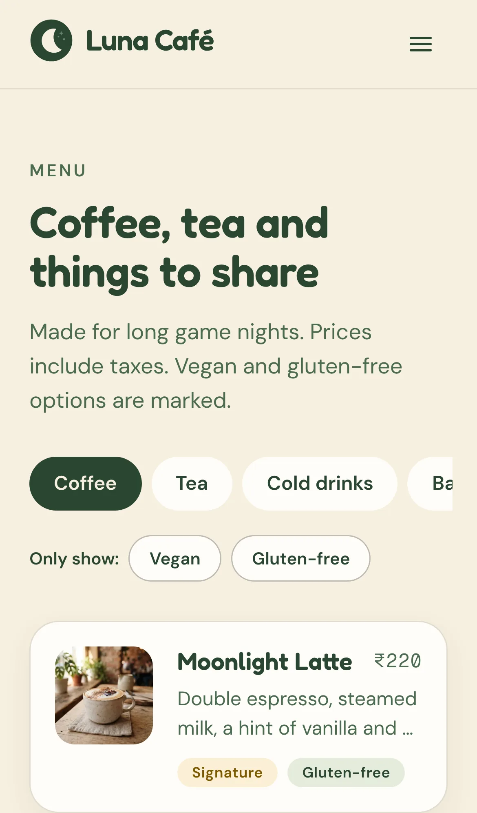
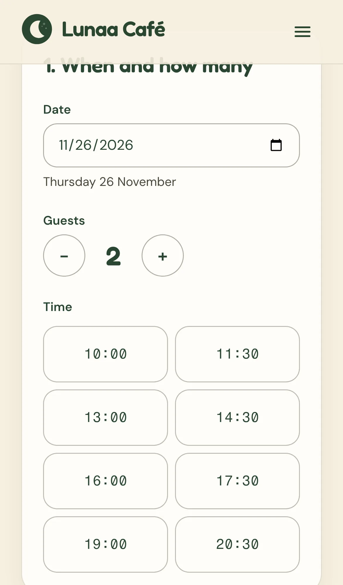

# Lunaa Café

> Coffee first. Then game on?

A portfolio project: the website of a fictional board game café. It opens as a calm specialty coffee shop, and the board game side is revealed as you scroll.

**Live:** https://lunaacafe.vercel.app · **Status:** complete (November 2026). Everything in the original plan is built and deployed: public pages, table booking with game reservations, the game quiz, events, the Moon Club card, the admin area, booking emails, animations and SEO. See [`docs/SPEC.md`](docs/SPEC.md) for the original plan and [`docs/CASE_STUDY.md`](docs/CASE_STUDY.md) for how it was built.

<p align="center">
  
</p>

<p>
  
  
  
  
  
  
</p>
<p>
  
  
  
</p>

More: [about](docs/screenshots/about.webp) · [game library](docs/screenshots/games-library.webp) · [booking form](docs/screenshots/book.webp) · [booking confirmed](docs/screenshots/book-confirmed.webp) · [Moon Club card](docs/screenshots/moon-club.webp) · [admin](docs/screenshots/admin.webp)

**Case study:** how it was built and the problems along the way, in [`docs/CASE_STUDY.md`](docs/CASE_STUDY.md).

## Stack

- **Client:** Vite, React 19, TypeScript, Tailwind CSS v4, Motion, React Router, TanStack Query
- **Server:** Node 22, Express 5, TypeScript, Mongoose (MongoDB Atlas), zod
- **Hosting:** Vercel (client, rewrites `/api` to the server), Render (API), MongoDB Atlas M0

## Project layout

```
client/   React app
server/   Express API
e2e/      Playwright end-to-end tests
docs/     spec, case study, screenshots
design/   Stitch mockups and the original design-system notes (visual reference only)
```

## Run it locally

1. Install dependencies: `npm run install:all`
2. Create `server/.env` from `server/.env.example` and set `MONGODB_URI` (and the admin values).
3. Seed the database: `npm --prefix server run seed` (tables, games, menu, four upcoming sample events, admin account). Safe to run again: it updates instead of duplicating, and keeps event sign-ups.
4. Start the API: `npm run dev:server` (http://localhost:4000/api/health)
5. Start the site in a second tab: `npm run dev:client` (http://localhost:5173)

## Emails

After a booking or an event sign-up the API sends a confirmation (reference code, date, time, table, game) with a calendar file attached, and staff in `ADMIN_NOTIFY_EMAIL` get an alert (who, which slot, table, game, phone, and when it was booked). All of it goes through Brevo's HTTP API (Render's free plan blocks SMTP). Sending happens in the background: a booking never waits for it, and a failed email never fails a booking. The emails say clearly that Lunaa Café is a fictional portfolio café. Templates: `server/src/emails/`.

## Admin

The staff area lives at `/admin` (not linked from the site, and `robots.txt` asks search engines to skip it). Sign in with `ADMIN_EMAIL` / `ADMIN_PASSWORD` from `server/.env`; the account is created by `npm --prefix server run seed`.

- **Today:** bookings and guests today, bookings this week, unread messages, today's tables, and the latest bookings with when each was made
- **Reservations:** filter by date range and status, cancel (frees the table immediately)
- **Games, Menu, Events:** add, edit, hide (untick "Available") or delete
- **Messages:** contact-form messages, mark read/unread, delete
- **Account:** change the admin password (at least 12 characters; signs out every other session)

Security: rate limits key on the visitor's real IP (Express trusts two proxy hops in production: Vercel's rewrite and Render's proxy; override with `TRUST_PROXY_HOPS`), bcrypt-hashed password, 8-hour JWT in an httpOnly, SameSite=Lax cookie (Secure in production), login rate limit, same error for unknown email and wrong password, and admin POSTs must be JSON (blocks cross-site form posts).

## Animations

Built with Motion plus plain CSS, in `client/src/components/fx/`:

- **Home hero:** the headline's letters rise out of a mask one by one, board-game pieces drift behind it (each at its own depth, moving with scroll and leaning away from the mouse), and as you scroll a golden moon rises behind the cup while the text drifts off. Two text ribbons cross at the bottom.
- **Every page:** split-letter titles with floating pieces, sections that slide, flip, zoom or un-blur into view, 3D tilt with a soft glare on cards, magnetic buttons, a moon-ring cursor (mouse only), a scroll progress bar with a little moon, a header that tucks away while you scroll down, a sliding nav highlight, and a moon-iris transition between pages.
- **Moments:** the game quiz rolls two real 3D dice before dealing out the matches like cards; a booking ends with confetti (paper, dice and stars), a flipping ticket and a reference code that rolls like a slot machine; the Moon Club card tilts, has a flip side, bursts on each stamp and celebrates a full cycle. Event sign-ups and contact messages get confetti too.

Kept honest: everything respects the system's *reduce motion* setting; content near the top of a page uses CSS entrances, so it plays as soon as the HTML paints instead of waiting for JavaScript; the confetti code is only downloaded when something is celebrated; the cursor and tilt never run on touch screens.

## SEO and sharing

- **Pre-rendered pages:** `npm run build` renders Home, Games, Menu, Events, About, Contact and Book to real HTML (`client/scripts/prerender.mjs`, using the same React components via `src/entry-server.tsx`). Crawlers and link previews see the full content without running JavaScript; the browser then attaches to that HTML (hydration) instead of starting from a blank page. On Vercel the build also fetches the live menu, games and events and bakes them in (the browser refreshes them straight after loading). Local and CI builds skip that, so tests never see live data.
- **Per-page tags:** title, description, canonical URL, Open Graph and Twitter card for every page, from one list in `client/src/lib/seo.ts` (also used to update the tags when you move between pages).
- **Share image:** `client/public/og.jpg` (1200×630).
- **Structured data:** `CafeOrCoffeeShop` (address, hours, menu, reservations) on every page and an `Event` for each upcoming event on `/events`, for rich results in Google. (The café is fictional; this shows the technique.)
- **Crawling:** `sitemap.xml` is generated at build time, `robots.txt` points to it and keeps `/admin` out, and every address without a page of its own (admin, unknown links) is served with `noindex`.
- Plus a web app manifest and app icons.

## Performance and accessibility

Lighthouse 12, production build behind a local copy of the Vercel setup (same rewrites and headers, Brotli). Mobile uses Lighthouse's slow-4G throttling and moves a few points between runs, so ranges are from two runs:

| Page | Mobile perf | Desktop perf | Accessibility | Best practices | SEO |
|---|---|---|---|---|---|
| Home | 87–98 | 96 | 100 | 100 | 100 |
| Games | 95–96 | 99–100 | 100 | 100 | 100 |
| Menu | 88–96 | 97–100 | 100 | 100 | 100 |
| Events | 91–94 | 99 | 100 | 100 | 100 |
| About | 98 | 98–99 | 100 | 100 | 100 |
| Contact | 90–96 | 99 | 100 | 100 | 100 |
| Book | 84–87 | 98 | 100 | 100 | 100 |

What keeps it fast: pages arrive as pre-rendered HTML; every page except Home and the animation engine load on demand; headlines and above-the-fold content animate with CSS, so they paint without waiting for JavaScript; the first menu photos load with high priority and the rest lazily; fonts are self-hosted; built assets are cached for a year. Layout shift stays near zero (CLS ≤ 0.02).

The free API sleeps when idle. The site waits up to 2.5 minutes for it with a "Waking up the café…" banner, retrying reads, and retrying writes only when the request clearly never reached the server (so nothing is saved twice).

## Photos

Food, drink and café photos were generated with Gemini for this fictional café (originals in `design/photos/`; the interior and storefront were retouched so the signs say Lunaa Café). The site serves compressed WebP copies from `client/public/images/`; menu items point at theirs through the `image` field, set by the seed. Game cards, icons, the map and the moon motifs are drawn in code. The hero photo is configured in `client/src/lib/cafe.ts` (`HERO_PHOTO`).

## Tests

- `npm test`: server tests (Vitest + Supertest against a throwaway in-memory MongoDB; the first run downloads it). They cover café hours and slots in café time (Asia/Kolkata), smallest-table assignment, double booking blocked under simultaneous requests (unique database index), cancellation freeing a slot, nearest free times, event sign-ups that never overfill, admin auth (cookie flags, CSRF guard, password change ending other sessions), the proxy/IP setup behind Vercel and Render, and API validation errors.
- `npm --prefix client test`: client unit tests (quiz scoring, moon phases, cold-start retry rules, page tags).
- `npm run e2e`: Playwright end-to-end tests on the built app with a real API and MongoDB, on desktop and a phone-sized screen: book a table with a game and cancel it as staff, a full slot can't be picked, the quiz, filters surviving a reload, a contact message reaching the admin inbox, and admin pages needing a session. First time: `npm --prefix e2e install && npm --prefix e2e run setup` (downloads the test browser), then copy `e2e/.env.example` to `e2e/.env` and point `MONGODB_URI` at a throwaway database (e.g. `/luna-cafe-e2e`). The tests refuse to run against `luna-cafe`, and they seed the test database first.

CI (GitHub Actions) runs all three on every push and pull request; the end-to-end job uses a MongoDB service container and uploads the Playwright report if anything fails.

## API

| Method | Path | Notes |
|---|---|---|
| GET | `/api/health` | `{ status, db }` |
| GET | `/api/games` | available games |
| GET | `/api/games/:slug` | one game |
| GET | `/api/menu` | available menu items |
| GET | `/api/menu/special` | today's special (falls back to a signature drink) |
| GET | `/api/reservations/slots` | the fixed time slots |
| GET | `/api/reservations/availability?date=YYYY-MM-DD&partySize=4` | free / full / past / closed per slot |
| POST | `/api/reservations` | `{ name, email, phone, date, slotId, partySize, gameId? }` → reference code, or 409 with suggestions |
| POST | `/api/contact` | `{ name, email, message }` |
| GET | `/api/events` | upcoming events with `spotsLeft` (never who signed up) |
| POST | `/api/events/:slug/signup` | `{ name, email }`; 409 when full or already signed up |
| POST | `/api/auth/login` · `/api/auth/logout` | admin session cookie |
| GET | `/api/auth/me` | current admin |
| POST | `/api/auth/password` | `{ currentPassword, newPassword }` (admin) |
| * | `/api/admin/games`, `/menu`, `/events` | list, create, `PATCH /:id`, `DELETE /:id` (admin) |
| GET | `/api/admin/summary`, `/api/admin/reservations?from&to&status`, `/api/admin/messages` | admin |
| PATCH | `/api/admin/reservations/:id/cancel`, `/api/admin/messages/:id` | admin |

## Deploying

The API runs on Render (free), the site on Vercel, the data on MongoDB Atlas. Vercel forwards `/api/*` to Render, so the browser only ever talks to one address (and the admin cookie stays first-party).

**1. MongoDB Atlas**
- Network Access → Add IP address → `0.0.0.0/0` (Render's free plan has no fixed IP). Keep a strong database password.
- Seed once from your machine: `npm --prefix server run seed`.

**2. API on Render**
- Dashboard → New → Blueprint → choose this repo. It reads `render.yaml` (service `luna-cafe`, root `server`, branch `main`).
- Or create a Web Service by hand: root directory `server`, build `npm ci --include=dev && npm run build`, start `npm start`, health check `/api/health`, and add `NODE_ENV=production`, `NODE_VERSION=22`, `MONGODB_URI`, `CLIENT_ORIGIN` and a random `JWT_SECRET`.
- Fill in `MONGODB_URI` (same as `server/.env`) and `CLIENT_ORIGIN` (your Vercel address, e.g. `https://luna-cafe.vercel.app`). `JWT_SECRET` is generated for you.
- Optional, booking emails: add `BREVO_API_KEY` (a key from Brevo → Settings → SMTP & API, one per project), `MAIL_FROM_ADDRESS` (a sender verified in Brevo) and, if you like, `MAIL_REPLY_TO` and `ADMIN_NOTIFY_EMAIL` (staff alerts for every new booking and event sign-up; comma-separated). Without them the API works the same and only logs that it would have sent an email.
- When it is live, open `https://luna-cafe.onrender.com/api/health`. It should say `"db":"connected"`.
- The free plan sleeps after 15 minutes without traffic and takes about a minute to wake. The site shows a "Waking up the café…" note meanwhile. No keep-alive ping on purpose: the free hours are shared with other projects in the same Render workspace.

**3. Site on Vercel**
- Vercel → Add New → Project → import `Luna-Cafe`. Set **Root Directory** to `client`. Everything else comes from `client/vercel.json` (Vite, `npm ci`, `npm run build`, output `dist`, Node 22). No environment variables are needed.
- `client/vercel.json` forwards `/api/*` to `https://luna-cafe.onrender.com`. If Render gave your service a different address (it adds a suffix when the name is taken), change that one line and push.
- `/games`, `/menu`, `/events`, `/about`, `/contact` and `/book` are served their pre-rendered HTML; every other address (`/admin/…`, unknown links) gets the app shell (`app.html`, marked `noindex`). `/assets/*` is cached for a year (file names change on every build).
- The build pre-renders the pages and, on Vercel, bakes in the live menu, games and events. If the API is asleep and doesn't wake within about a minute, the build still succeeds and those pages simply load their data in the browser. Redeploy (or push) to refresh the baked-in data; the browser always fetches fresh data anyway.
- Security headers: a strict Content-Security-Policy (only this site's own scripts, styles, fonts and API), `nosniff`, `frame-ancestors 'none'`, HSTS, a tight Permissions-Policy, and `noindex` on `/admin`.
- Production branch: `main`. Every pull request also gets its own preview URL.

**4. Check it**

```
npm run smoke -- https://your-site.vercel.app
```

The smoke test loads the site, a deep link and the `/admin` headers, then waits (up to two minutes) for the API to wake and checks health, games, menu, events and that the admin API is locked.

## Ideas for later

Not planned right now, but where the project could go next:

- A link in the confirmation email so guests can cancel their own booking
- Waitlists for full events, and a reminder email the day before a booking
- Photos for the menu items that still show an icon, and a sharper hero photo
- A custom domain

---

Portfolio project, fictional café. Game names belong to their owners.
