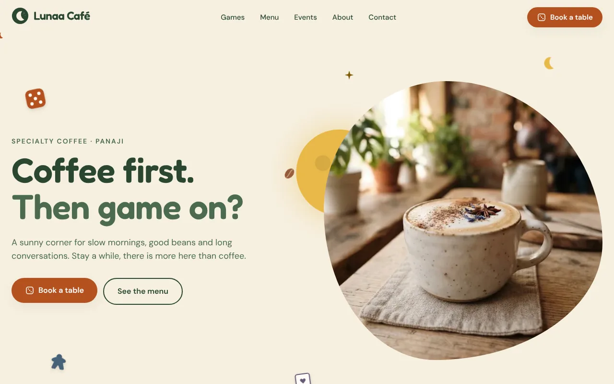
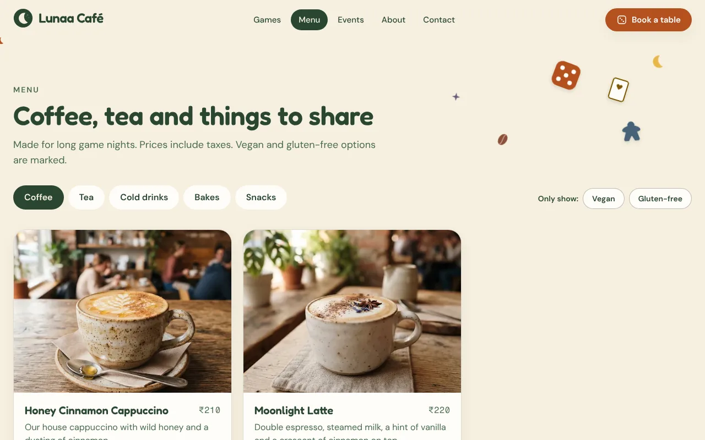
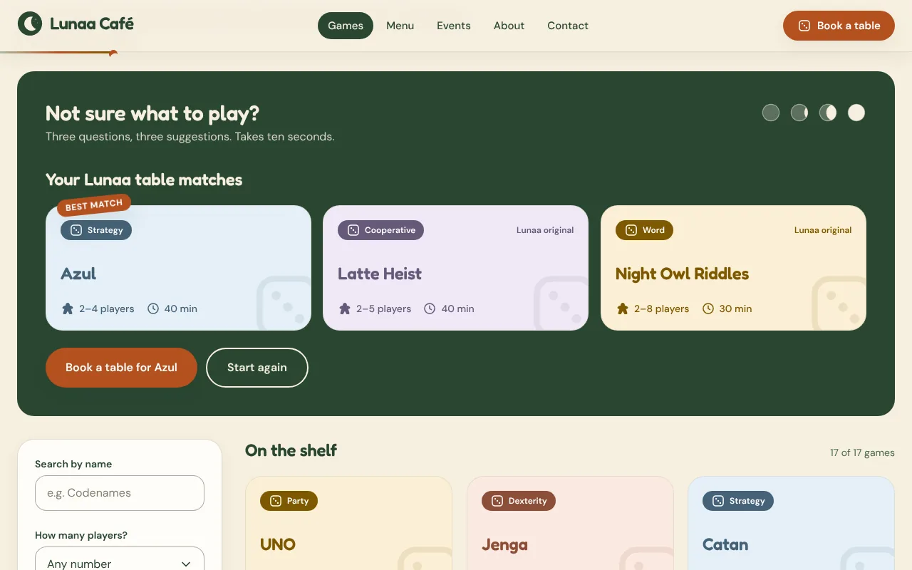
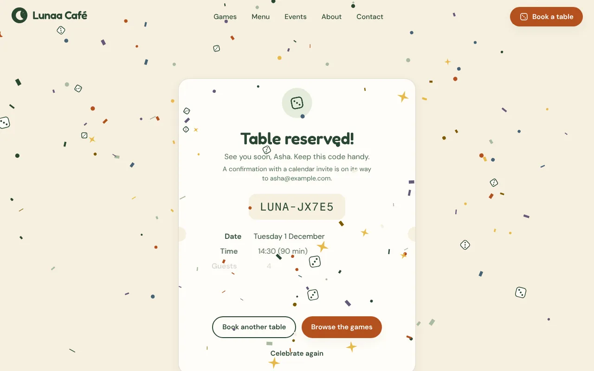
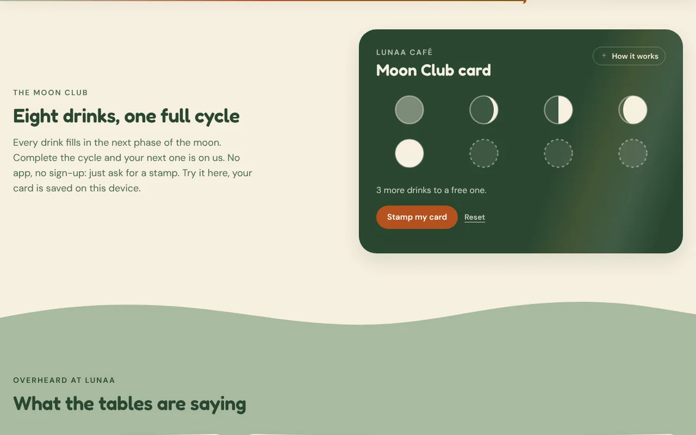
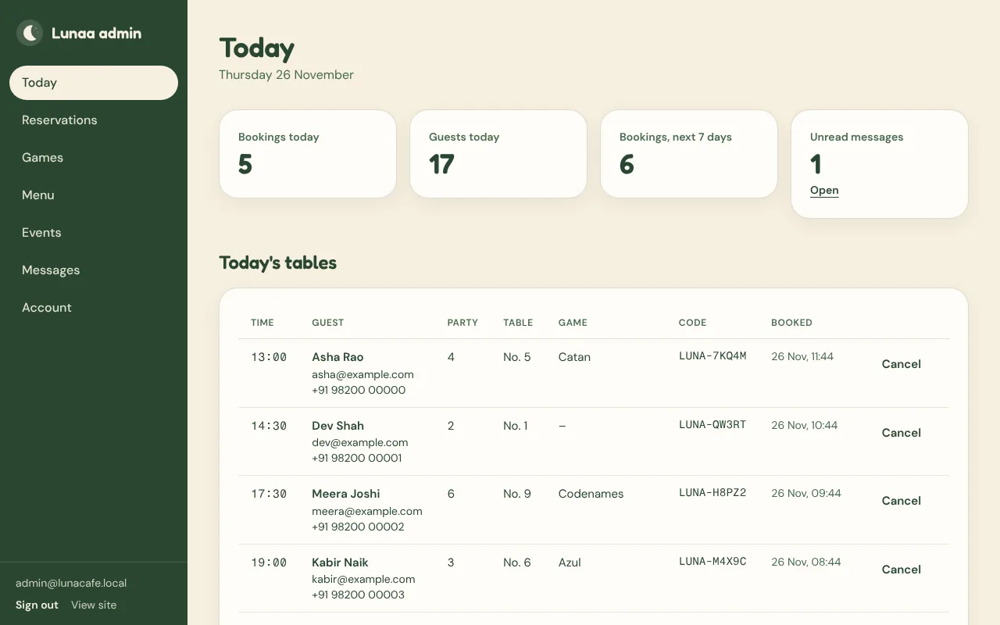

# Lunaa Café: case study

> Coffee first. Then game on?

**Live site:** https://lunaacafe.vercel.app · **Code:** https://github.com/Hemant-Mhalsekar/Luna-Cafe

<p align="center">
  
</p>

## In one paragraph

Lunaa Café is a full-stack website for a fictional board game café in Panaji, Goa. It opens like a calm specialty coffee shop, and the board game side is revealed as you scroll. Visitors can browse the menu and a library of games, take a ten-second quiz that picks a game for them, book a table (and reserve a game for it), sign up for game nights and collect stamps on a Moon Club loyalty card. Staff get a private admin area to see who booked what and when, and to manage games, menu, events and messages. It is built with React and TypeScript on the front end and an Express + MongoDB API on the back end, and it runs on free hosting (Vercel, Render, MongoDB Atlas).

## Goals

- **Feel like a real café, not a template.** A warm visual identity, real photos, writing in a friendly voice and animations with some personality.
- **Bookings that can't go wrong.** No table or game booked twice, even if two people click at the same moment.
- **Work well on free hosting.** The API sleeps when nobody is using it; the site has to cope gracefully.
- **Fast, accessible and findable.** Good Lighthouse scores on a phone, keyboard and screen reader friendly, and pages that search engines and link previews can read.

## What it does

| For visitors | For staff (`/admin`) |
|---|---|
| Menu with photos, dietary filters and today's special | Today's tables, guests and bookings at a glance |
| Game library with filters (players, time, type, mood) | The latest bookings with *when* each was made |
| A three-question quiz that suggests three games | Reservations by date and status; cancel to free a table |
| Booking: date, party size, live free/full times, optional game | Add, edit and hide games, menu items and events |
| Suggestions of the nearest free times when a slot is full | Contact messages inbox |
| Event sign-ups that can never overfill | Email alert for every new booking and sign-up |
| Confirmation email with a calendar invite | Password change that signs out every other session |
| Moon Club card (stamps saved on the device) | |

## Stack and architecture

```
Browser ──► Vercel (React app, pre-rendered pages)
               │  /api/* is forwarded, so the browser only talks to one address
               ▼
            Render (Express 5 API, Node 22) ──► MongoDB Atlas
               │
               └──► Brevo (confirmation and staff emails)
```

- **Client:** Vite, React 19, TypeScript, Tailwind CSS v4, Motion, React Router, TanStack Query
- **Server:** Express 5, TypeScript, Mongoose, zod validation, JWT in an httpOnly cookie, bcrypt
- **Tests:** Vitest + Supertest (with an in-memory MongoDB), Playwright end-to-end on desktop and phone sizes, GitHub Actions CI

## Design

The design started from a set of mockups and a small design system: cream, sage and forest green, with orange kept strictly for actions (every "book" button), a rounded display font (Fredoka) and moon motifs throughout. Colour pairs were checked for contrast and the rules written into the tokens (for example, mid-green text is never used on the sage background). Food and café photos were generated for this fictional café and retouched so the signs say "Lunaa Café". Game cards, icons, the map and the moon phases are drawn in code.

## Problems worth talking about

### 1. No double bookings, even at the same instant

Checking "is this table free?" and then saving the booking leaves a gap where two requests can both see the table as free. Instead, the database enforces it: a **unique partial index** on table + date + time slot for confirmed bookings, and a second one on game + date + time slot (the café has one copy of each game). If two requests race, one wins and the other gets a clear "just taken" answer with the nearest free times. Cancelling a booking changes its status, so the slot frees up immediately. Event sign-ups use a single atomic update that only succeeds while seats are left. Tests fire simultaneous requests to prove it.

### 2. Time zones

The café runs on India time (UTC+5:30) while the servers run on UTC. All "today", "past" and "Monday closed" logic is done in café time on both sides, and confirmation emails format dates by hand, because Node's date formatting differed from the browser's.

### 3. Living with free hosting

- **Cold starts.** The free API sleeps after 15 minutes and takes up to a minute to wake. The site shows a "Waking up the café…" note and retries patiently. Reads retry on any sign of a sleeping server, but writes (bookings, sign-ups) only retry when the request clearly never arrived, so nothing is ever saved twice.
- **Email.** Render's free plan blocks SMTP, so emails go through Brevo's HTTP API. Sending happens in the background: a booking never waits for an email, and a failed email never fails a booking.
- **A crash that looked like a hang.** After a settings change the API kept "waking" for over ten minutes. The cause was an invalid optional email setting failing validation at startup. Optional settings are now cleaned up (quotes, spaces, `Name <email>` formats) and skipped with a warning instead of stopping the server.

### 4. Security behind two proxies

Requests pass through Vercel's rewrite and Render's proxy, so at first every visitor looked like it came from a Vercel IP, and the rate limits treated everyone as one person. Express now trusts exactly two proxy hops, which was verified on the live site. Other measures: an httpOnly, SameSite cookie for the admin session (first-party thanks to the `/api` rewrite), the same error for an unknown email and a wrong password, a login rate limit, JSON-only admin requests, a strict Content-Security-Policy and `noindex` on the admin area.

### 5. Animations that don't cost speed or accessibility

The brief was "go fully crazy": split-letter headlines, floating game pieces, a moon that rises as you scroll, 3D tilting cards, a custom cursor, a moon-shaped page transition, 3D dice in the quiz and confetti when a table is booked. To keep it fast and inclusive:

- The animation library loads after the first paint; anything near the top of a page animates with CSS, so it shows as soon as the HTML arrives.
- Confetti code downloads only when something is celebrated.
- Everything respects the *reduce motion* setting, and the cursor and tilt effects never run on touch screens.
- The end-to-end tests caught a subtle bug: splitting headings into animated letters made screen readers read "C o f f e e". The letters now stay inline and move with a relative offset, so the heading reads as words again.
- A feedback loop made tilting cards jitter (the card measured itself while rotating). It now measures a box that never moves.

### 6. SEO for a single-page app

A React single-page app sends search engines an almost empty page with one shared title. Now:

- Each public page is **pre-rendered to HTML at build time** with the same React components, and the browser attaches to that HTML instead of starting over.
- On Vercel, the build fetches the live menu, games and events and bakes them in, so even crawlers that don't run JavaScript see them. The data is passed in a non-executable JSON block, because the strict Content-Security-Policy forbids inline scripts. Test builds skip this, so tests never see live data.
- Every page has its own title, description, canonical link and social preview, plus structured data for the café and each event, a generated sitemap, and `noindex` on everything that isn't a real page.
- Things that differ between build time and the visitor's browser were handled explicitly: the loyalty card reads saved stamps through a small external store, and the booking page, which depends on today's date, is rendered fresh in the browser.

## Testing and quality

- **62 server tests** covering opening hours and slots in café time, smallest-table assignment, double booking under simultaneous requests, cancellations, nearest free times, events that never overfill, admin authentication (cookie flags, CSRF guard, sessions ending after a password change), the proxy setup and validation errors.
- **Client unit tests** for quiz scoring, moon phases, the cold-start retry rules and the page tags.
- **11 Playwright end-to-end tests** on desktop and phone sizes: booking with a game and cancelling it as staff, full slots, a reserved game showing as taken, the quiz, filters surviving a reload, a contact message reaching the admin inbox, and admin pages requiring a session.
- **CI** runs all three on every push and pull request, with a real MongoDB for the end-to-end tests.

**Lighthouse** (production build, mobile on slow 4G): accessibility, best practices and SEO **100** on every page; performance **96–100 on desktop** and **84–98 on mobile** depending on the page and run.

## What I'd do next

- A link in the confirmation email so guests can cancel their own booking
- Photos for the remaining menu items and a sharper hero image
- A custom domain
- Waitlists for full events, and reminders the day before a booking

## Screenshots

<p>
  
  
  
  
  
  
</p>

---

Portfolio project. Lunaa Café is fictional. Game names belong to their owners.
